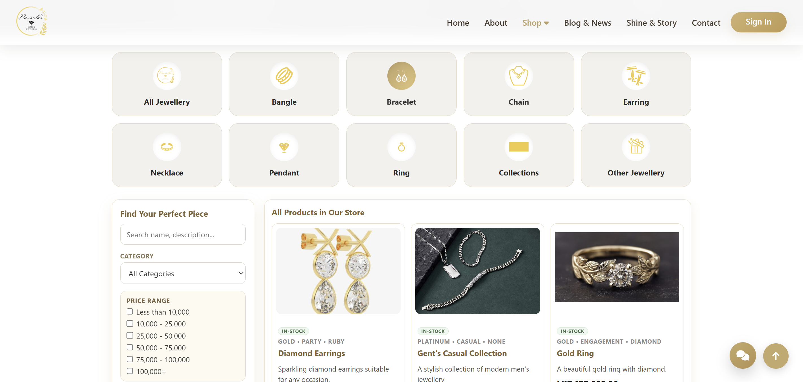
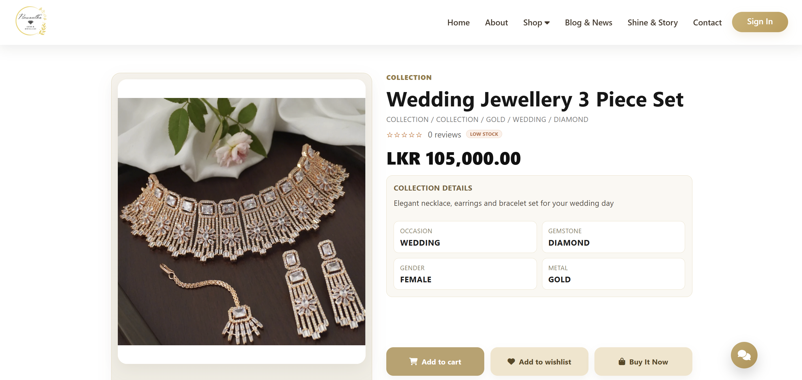
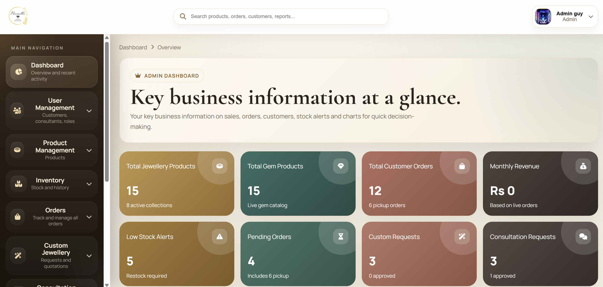

# Gems & Jewellery Management

A Laravel web application for browsing gems and jewellery, managing an online shop, and coordinating customer services such as custom jewellery requests and consultations. The repository is an academic group project.

> **Project setup note:** The included MySQL database snapshot is currently the most complete source for the application's schema and sample data. The checked-in migrations do not create all of the product-catalog base tables; see [Database setup](#database-setup) before setting up a fresh copy.

## Contents

- [Project overview](#project-overview)
- [Features](#features)
- [Technology stack](#technology-stack)
- [My contribution](#my-contribution)
- [Database structure](#database-structure)
- [Prerequisites](#prerequisites)
- [Installation and local setup](#installation-and-local-setup)
- [Configuration](#configuration)
- [Running the application](#running-the-application)
- [Tests](#tests)
- [Screenshots](#screenshots)

## Project overview

The application brings together a gem and jewellery catalogue, customer shopping workflows, and administrative tools. Customers can browse and filter products, manage a cart and wishlist, submit orders and reviews, and make service requests. Admin and consultant workflows support managing catalogue and customer-service records.

The application is built with Laravel and Blade-rendered views. Its backend uses Eloquent models and Laravel routes/controllers, with a MySQL/MariaDB SQL snapshot included in the repository.

## Features

The following are represented in the current routes, controllers, views, models, and database snapshot:

- **Catalogue:** Browse gems and jewellery, filter listings, view product details, and submit product reviews.
- **Accounts:** Sign up and sign in, update a profile, manage a profile image, and use Google sign-in when OAuth credentials are configured.
- **Shopping:** Maintain a cart and wishlist, proceed through checkout, and view order-related account pages.
- **Orders and returns:** Store orders and order items, choose shipping and payment-method values, and submit return/refund requests. Admin routes support order and return management.
- **Custom jewellery:** Submit a design request with preferences and reference images; manage quotations and accept or reject them.
- **Consultations and appointments:** Submit consultation requests, exchange messages, request appointments, and manage request or appointment statuses through customer and consultant routes.
- **Administration:** Dashboard and reporting pages, catalogue and stock management, user and permission management, review moderation, contact-message handling, and notification management.
- **Site content:** Public information pages, blog posts, FAQs, and newsletter subscriptions, with admin interfaces for managing posts and FAQs.
- **Metal-based pricing:** Jewellery prices can be calculated from metal, weight, purity, wastage, making charge, and a market factor. The pricing service can retrieve metal rates from MetalPriceAPI and cache them; it falls back to the product's stored price when usable rates are unavailable.
- **Astrology-related pages:** Authenticated astrology pages and supporting zodiac/birthstone data are present.

The codebase contains a `payhere_payments` table in the SQL snapshot. Its presence does not by itself establish that a payment gateway is operational; configure and verify a gateway integration separately before relying on online payment processing.

## Technology stack

| Area | Technologies found in the repository |
|---|---|
| Backend | PHP `^8.2`, Laravel `^12.0`, Laravel Eloquent |
| Server-rendered UI | Blade templates, HTML, CSS, JavaScript |
| Frontend build and styling | Vite `^7`, Tailwind CSS `^4`, Laravel Vite plugin |
| JavaScript utilities | Axios; Concurrently for the Composer development script |
| Database | Laravel supports SQLite and MySQL/MariaDB in configuration; the supplied SQL backup is MySQL-format |
| Testing tools | PHPUnit `^11.5`, Laravel test runner |

No separate frontend framework such as React or Vue is declared in the project dependencies.

## My contribution

This was a **group project**, not an individually developed application. My individual responsibilities were:

- **100% of the backend development**
- **100% of the database design and implementation**
- **All system design diagrams**
- **UI implementation for selected pages**

Other parts of the overall application were completed collaboratively by the group.

## System Design

This project involved designing the system architecture
and documenting the application's major components.

The system design documentation includes:

- Use Case Diagrams
- Entity Relationship Diagram (ERD)
- Class Diagrams
- Sequence Diagrams
- Activity Diagrams

Diagrams are available in the `docs/diagrams/` directory.

## Database structure

The SQL snapshot is at [`database/backups/gems_jewellery_db.sql`](database/backups/gems_jewellery_db.sql). It contains a MySQL/MariaDB schema and data. Its tables cover these areas:

| Area | Tables |
|---|---|
| Accounts and Laravel infrastructure | `users`, `sessions`, `password_reset_tokens`, `cache`, `cache_locks`, `jobs`, `job_batches`, `failed_jobs`, `migrations` |
| Product catalogue | `products`, `categories`, `gems`, `gemtype`, `jewellery`, `jewellerytype`, `collections`, `product_birthstones`, `product_360_previews`, `product_reviews`, `product_views` |
| Shopping and orders | `carts`, `cart_items`, `wishlist_items`, `orders`, `order_items`, `order_returns`, `payhere_payments` |
| Custom jewellery | `custom_jewellery_requests`, `custom_jewellery_quotations` |
| Customer service | `contact_messages`, `consultation_requests`, `consultation_messages`, `appointments`, `newsletter_subscribers` |
| Content and administration | `content_posts`, `faq_entries`, `site_notifications`, `admin_activity_logs` |
| Astrology/reference data | `astrology`, `birthstone_months`, `zodiac_signs` |

Key relationships encoded by the migrations include:

- A user has a cart, and a cart has cart items.
- A user can have orders, each of which can contain order items.
- A user can save wishlist items.
- A custom jewellery request can have quotations.
- A consultation request can have messages; appointments link customers and optionally assigned consultants.
- Product reviews can reference a product and, where present, an order item.

The SQL snapshot is a schema/data export, not a complete database-design document. Check the SQL and migrations for field definitions and constraints when changing the schema.

### Database setup

The repository's Laravel configuration defaults to SQLite, but the committed migrations do **not** create the catalogue base tables (`products`, `categories`, `gems`, and `jewellery`). Consequently, running `php artisan migrate` against a brand-new empty SQLite database is not sufficient to create the full application schema.

For a local setup using the supplied data:

1. Start MySQL or MariaDB and create a **new, empty** database (for example, `gems_jewellery_management`) using `utf8mb4`.
2. Import `database/backups/gems_jewellery_db.sql` into that database using phpMyAdmin's **Import** tab or your MySQL/MariaDB client. The dump contains `DROP TABLE IF EXISTS` statements, so do not import it into a database whose existing data you need to preserve.
3. Configure the database values in `.env` as described below.
4. Do not blindly run `php artisan migrate` on the imported snapshot. The SQL dump already contains schema and migration metadata, while the repository migrations are incremental and do not provide all catalogue base-table creation. Check `php artisan migrate:status` and reconcile the migration history/schema before applying migrations to an imported database.

If you need a clean database without the snapshot's sample data, the project currently does not provide a complete set of migrations for a fresh catalogue schema; that schema will need to be supplied or completed separately.

## Prerequisites

- PHP 8.3 or newer and the PHP extensions required by Laravel and the configured database driver
- Composer
- Node.js and npm
- MySQL or MariaDB for importing the supplied SQL snapshot
- A web browser

## Installation and local setup

Run commands from the repository root.

1. **Install PHP dependencies:**

   ```sh
   composer install
   ```

2. **Create your local environment file:**

   ```sh
   cp .env.example .env
   ```

   On PowerShell, use:

   ```powershell
   Copy-Item .env.example .env
   ```

3. **Create and import the database** using the [database setup instructions](#database-setup).

4. **Configure `.env`** with the database credentials and local application URL:

   ```dotenv
   APP_NAME="Gems and Jewellery Management"
   APP_ENV=local
   APP_DEBUG=true
   APP_URL=http://127.0.0.1:8000

   DB_CONNECTION=mysql
   DB_HOST=127.0.0.1
   DB_PORT=3306
   DB_DATABASE=gems_jewellery_management
   DB_USERNAME=your_mysql_username
   DB_PASSWORD=your_mysql_password
   ```

   Replace the example database credentials with values for your local setup. Keep `.env` private and do not commit real credentials.

5. **Generate the application key:**

   ```sh
   php artisan key:generate
   ```

6. **Install frontend dependencies and build the assets:**

   ```sh
   npm install
   npm run build
   ```

7. **Link public storage** if you need uploaded files to be served locally:

   ```sh
   php artisan storage:link
   ```

## Configuration

The `.env.example` file provides the Laravel defaults. Common local settings include:

| Variable | Purpose |
|---|---|
| `APP_NAME`, `APP_ENV`, `APP_DEBUG`, `APP_URL` | Application name, environment, debug mode, and local URL |
| `DB_CONNECTION`, `DB_HOST`, `DB_PORT`, `DB_DATABASE`, `DB_USERNAME`, `DB_PASSWORD` | Database driver and connection; set these to the imported MySQL/MariaDB database |
| `GOOGLE_CLIENT_ID`, `GOOGLE_CLIENT_SECRET`, `GOOGLE_REDIRECT_URI` | Optional Google sign-in credentials and callback URL |
| `METALPRICEAPI_KEY` | Optional key for live metal-price data |
| `METALPRICEAPI_BASE_CURRENCY`, `METALPRICEAPI_QUOTE_CURRENCY`, `METALPRICEAPI_CACHE_MINUTES`, `METALPRICEAPI_MARKET_FACTOR` | Metal-price request and pricing settings; defaults are defined in `config/services.php` |
| `MAIL_MAILER` and other `MAIL_*` values | Mail transport; the example environment uses the `log` mailer |

Google sign-in requires OAuth client credentials and a redirect URI registered with Google that matches the local callback route. The metal-price API key is only needed for external rate retrieval; the pricing service has a stored-price fallback.

## Running the application

For a single-command local development environment, run:

```sh
composer run dev
```

The Composer script starts Laravel's development server, queue listener, log tailer, and Vite development server together. It stops the other processes when one exits.

Alternatively, run the web server and Vite separately in two terminals:

```sh
php artisan serve
```

```sh
npm run dev
```

Open the URL shown by `php artisan serve` (by default, `http://127.0.0.1:8000`).

## Tests

Run the project's Laravel/PHPUnit test suite with:

```sh
composer test
```

## Screenshots

The following image paths are placeholders. Add screenshots at these paths or update the links to match the screenshots you publish.

### Home page


### Gem and jewellery catalogue



### Product details and shopping



### Admin or consultant dashboard


